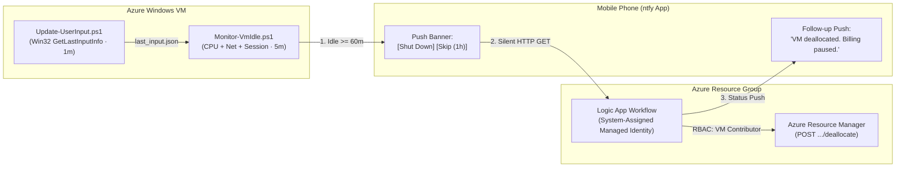

# Azure VM Idle Guardian (`azure-vm-idle-guardian`)

A lightweight, zero-cost-overhead idle detection and **1-tap mobile push approval** system for Azure Windows Virtual Machines.

When your VM has been idle for **1 hour** across **mouse movement, keyboard input, RDP/Console user sessions, CPU usage, and network throughput**, it sends a silent-action push notification to your phone via [ntfy.sh](https://ntfy.sh) with two inline buttons: **`Shut Down`** and **`Skip (1h)`**.

Tapping **`Shut Down`** executes silently in the background (without opening a browser window), triggers an **Azure Logic App** secured with a **System-Assigned Managed Identity**, deallocates the VM to stop compute billing, and sends a follow-up push notification once deallocation completes.

---

## Architecture



---

## Key Features

- **True Desktop Idle Detection:** Uses native Win32 `user32.dll!GetLastInputInfo()` inside the active desktop session so reading or moving the mouse keeps the VM awake even when CPU is near 0%.
- **Multi-Signal 1-Hour Rolling Window:** Requires all four conditions to hold over 60 minutes:
  1. **No mouse movement or keystrokes** (`>= 60 mins`)
  2. **No active interactive session input** (`quser` RDP/Console check)
  3. **Low CPU usage** (`<= 5.0%` rolling 1-hour average)
  4. **Low Network activity** (`<= 100 KB/s` rolling 1-hour average)
- **Zero-Browser Background Actions:** Uses `ntfy` HTTP background actions (`"action": "http"`, `"clear": true`) so tapping **`Shut Down`** or **`Skip (1h)`** on your phone lock screen dismisses the banner and runs in the background.
- **Completion Confirmation:** The Azure Logic App waits for Azure Resource Manager to finish deallocating the VM and sends a minimal follow-up notification:
  - **Approved:** `<vm-name> stopped — VM deallocated. Billing paused.`
  - **Skipped:** `Shutdown skipped — <vm-name> stays running (snoozed 1h).`
- **Passwordless Security:** The Logic App authenticates to Azure Resource Manager using a **System-Assigned Managed Identity** scoped strictly to `Virtual Machine Contributor` on the target VM.

---

## Repository Structure

```text
azure-vm-idle-guardian/
├── config/
│   └── config.example.json             # Sample configuration template
├── infra/
│   └── main.bicep                      # Bicep template (Logic App + Managed Identity + RBAC)
├── scripts/
│   ├── Deploy-AzureIdleGuardian.ps1    # 1-command end-to-end installer
│   └── Uninstall-AzureIdleGuardian.ps1 # Clean uninstaller (local tasks + Azure Logic App)
├── src/
│   ├── Monitor-VmIdle.ps1              # 5-minute rolling metric & idle evaluator
│   ├── Update-UserInput.ps1            # 1-minute Win32 GetLastInputInfo session tracker
│   └── RunHidden.vbs                   # Windowless launcher (prevents console flicker)
├── .gitignore
├── LICENSE
└── README.md
```

---

## Quickstart

### Prerequisites
- **Azure CLI (`az`)** installed and signed in (`az login`).
- **ntfy mobile app** installed on [Android](https://play.google.com/store/apps/details?id=io.heckel.ntfy) or [iOS](https://apps.apple.com/us/app/ntfy/id1625396347).

### 1. Deploy Infrastructure & Local Tasks

Run the installer from PowerShell on your Azure Windows VM:

```powershell
.\scripts\Deploy-AzureIdleGuardian.ps1 `
    -VmName "my-azure-vm" `
    -ResourceGroup "my-resource-group" `
    -NtfyTopic "my-vm-idle-secret-topic"
```

### 2. Subscribe on Your Phone

Open the **ntfy** app on your phone, tap **`+`**, and subscribe to the topic printed by the deployment script (e.g. `my-vm-idle-secret-topic`).

### 3. Send a Test Push Notification

Verify end-to-end delivery at any time:

```powershell
& "C:\ProgramData\AzureIdleMonitor\Monitor-VmIdle.ps1" -SendTestNotification
```

---

## Configuration Options (`C:\ProgramData\AzureIdleMonitor\config.json`)

| Property | Default | Description |
| :--- | :--- | :--- |
| `vmName` | *(Required)* | Name of the Azure Virtual Machine. |
| `resourceGroup` | *(Required)* | Azure Resource Group containing the VM. |
| `idleThresholdMinutes` | `60` | Minutes of continuous inactivity required before alerting. |
| `maxAvgCpuPercent` | `5.0` | Maximum 1-hour rolling average CPU percentage considered idle. |
| `maxAvgNetKbps` | `100.0` | Maximum 1-hour rolling average network throughput (KB/s) considered idle. |
| `notificationCooldownMinutes` | `60` | Snooze duration after an alert is sent or skipped. |
| `ntfyServerUrl` | `https://ntfy.sh` | ntfy server endpoint (supports self-hosted instances). |
| `ntfyTopic` | *(Required)* | Secret topic name subscribed to in the ntfy mobile app. |

---

## Uninstall

To remove the Windows Scheduled Tasks, local state directory, and Azure Logic App:

```powershell
.\scripts\Uninstall-AzureIdleGuardian.ps1 `
    -VmName "my-azure-vm" `
    -ResourceGroup "my-resource-group" `
    -RemoveAzureResources
```

---

## License

Released under the [MIT License](LICENSE).
